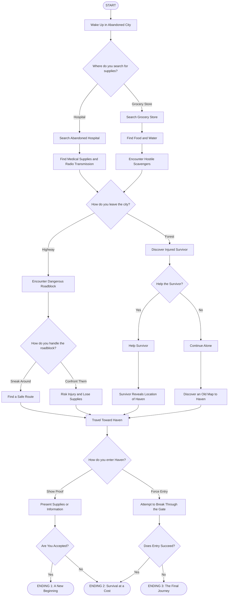

# WEB-115-Final-Project-Group-5
# Final Project: Last survivors

## Table of Contents
- [Team Members and Roles](#team-members-and-roles)
- [Application Overview](#application-overview)
- [Story Flowchart](#story-flowchart)

## Team Members and Roles

| Team Member | Role | Responsibilities |
|-------------|------|------------------|
| Ming Chen | Project Lead | Coordinates meetings, manages repo, final review |
| David Kirby Dean | Story & Gameplay Designer | Writes the narrative, designs decision points |
| Daniel Santiago Freire Leyton | Documentation Lead | Maintains README |

## Application Overview

**The Last survivors** is a text-based choose-your-own-adventure survival game. The player wakes up alone in an abandoned city with no supplies and no memory of how they got there. To survive, they must scavenge for resources, decide how to leave the city, navigate dangerous encounters on the road, and finally attempt to gain entry into **Haven** a rumored survivor settlement.

**Rules & Navigation:**
- Each screen presents a scene and a set of numbered choices.
- The player pick of their choice to proceed.
- Some choices lead to dead ends or alternate endings.
- The game has three possible endings depending on the player's decisions.

## Story Flowchart

