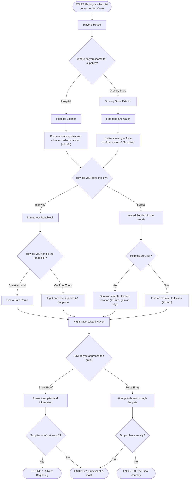

# WEB-115 Final Project – Group 5
# Survivors: A Choice-Based Story Game

## Table of Contents
- [Team Members and Roles](#team-members-and-roles)
- [Application Overview](#application-overview)
- [Rules and Navigation](#rules-and-navigation)
- [Story Flowchart](#story-flowchart)

## Team Members and Roles

| Team Member | Role | Responsibilities |
|-------------|------|------------------|
| Ming Chen | Project Lead | Coordinates meetings, manages the repo, builds the game engine, final review |
| David Kirby Dean | Story & Gameplay Designer | Writes the narrative, designs decision points |
| Daniel Santiago Freire Leyton | Documentation Lead | Maintains the README |

## Application Overview

**Survivors** is a choice-based, visual-novel-style survival game built with HTML, CSS, and JavaScript.

Three weeks ago a deadly mist rolled down from the hills and turned everyone who breathed it into something no longer human. The player is **player**, one of the few people left in the quiet town of **Mist Creek**. With a bag, a knife, and a rumor on a looping radio broadcast, player sets out for **Haven**, a walled survivor settlement somewhere north of the ridge.

The story is told in three chapters:

1. **Chapter 1: The City.** player leaves his house and chooses to search the hospital or the grocery store. Each location gives a different reward and a different danger, such as a radio transmission about Haven or a hostile scavenger named Asha. player then decides how to leave town.
2. **Chapter 2: The Road.** On the highway player faces a burned-out roadblock and must sneak around it or confront the people behind it. In the forest he meets an injured survivor and must decide whether to help her or continue alone.
3. **Chapter 3: Haven.** At the gate player must convince the guards to let him in, either by showing proof of what he carries and knows, or by forcing his way through.

The choices the player makes earlier in the story are tracked in the background (supplies, information, and whether player helped the survivor). These decide whether Haven accepts, tolerates, or rejects him.

### Endings

The game has **three possible endings**:

- **Ending 1: A New Beginning.** player is accepted into Haven.
- **Ending 2: Survival at a Cost.** player gets in, but only barely and at a price.
- **Ending 3: The Final Journey.** Haven turns player away and he walks on alone.

## Rules and Navigation

- **Advance the story:** click the text box, or press **Space** or **Enter**. Clicking while text is still typing shows the full line instantly.
- **Make a choice:** when a decision appears, the options are shown inside the text box at the bottom of the screen. Click one to continue (or use Tab and Enter).
- **Stats:** gaining or losing supplies or information shows a small pop-up. Totals are displayed on the ending screen.
- **Save / Continue:** the **Save** button stores your place in the browser. **Continue Game** on the title screen resumes from the last save.
- **Music:** the **Music** button turns the soundtrack on or off.
- **Home:** returns to the title screen.
- Some choices lead to harder endings, so replay the game to see all three.

## Story Flowchart

